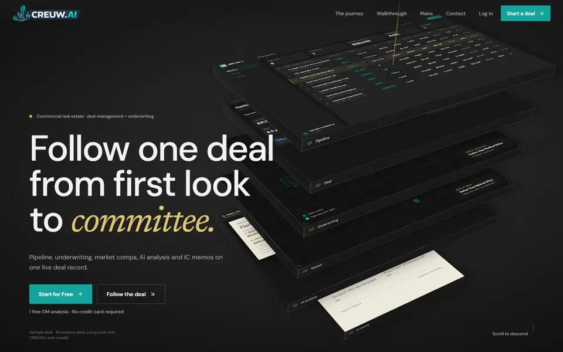
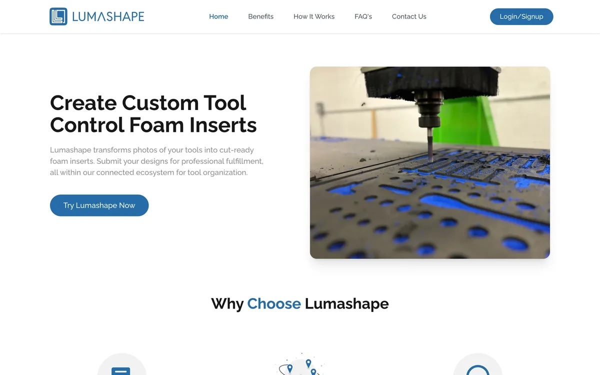
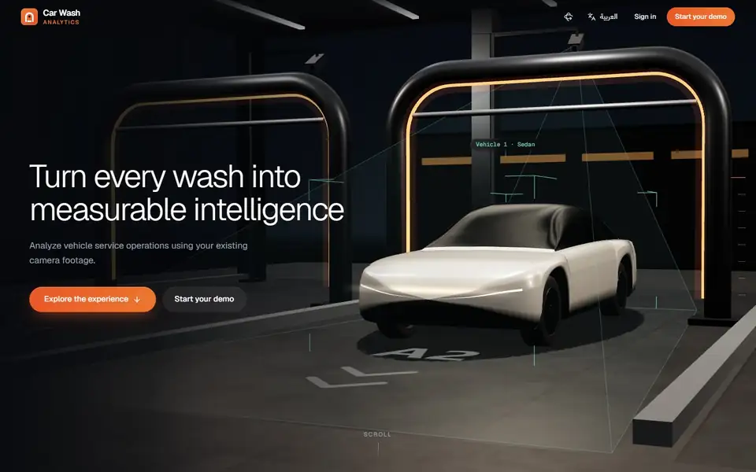
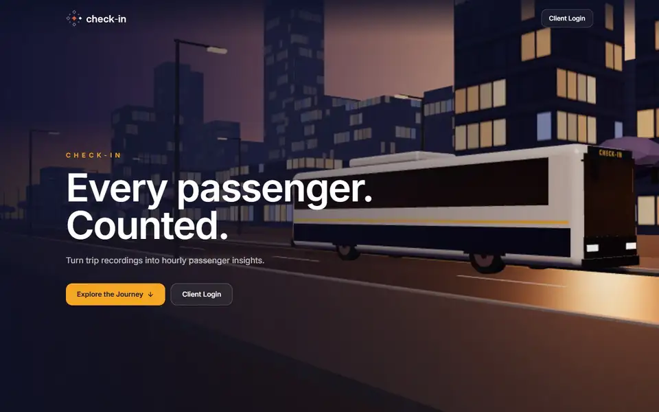
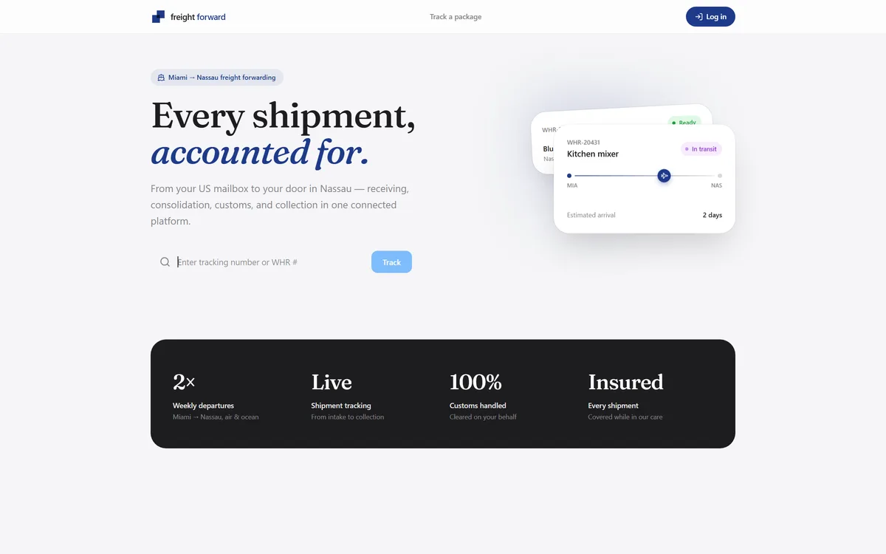
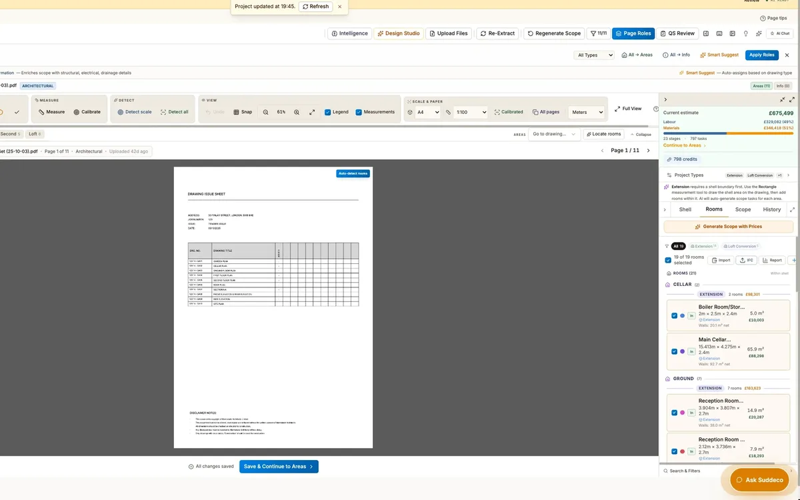
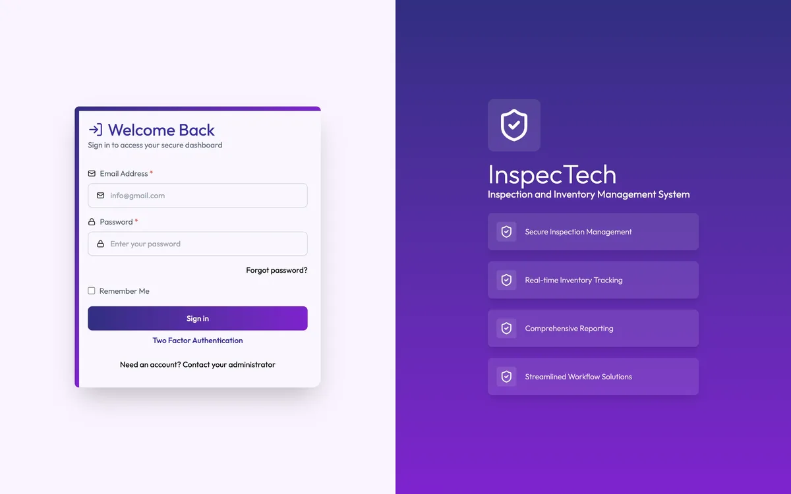
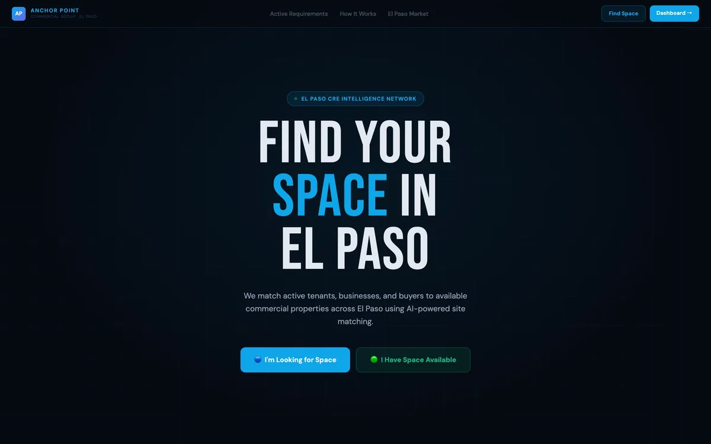
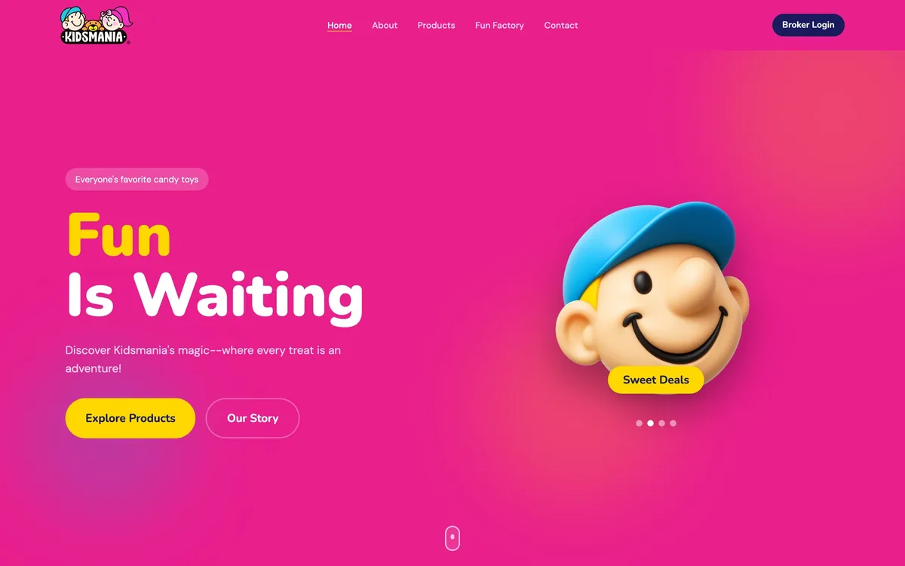
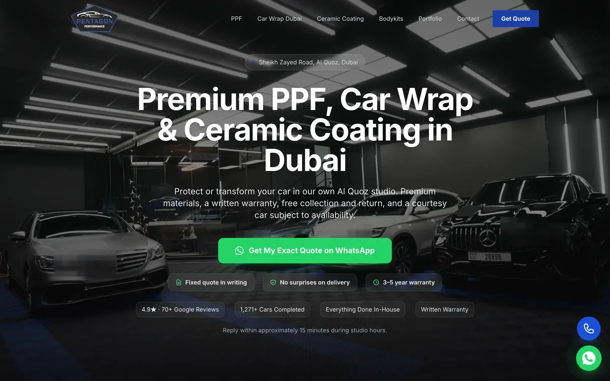

# Syed Wasi-Ul-Hassan

Full-stack engineer from Lahore. I build web products with Next.js, TypeScript and Node, and lately a lot of my work has been about putting AI into real business tools rather than demos.

I've been doing this professionally for 3+ years, mostly for clients in the US, the Gulf and Africa. I usually own a project from the database schema to the last screen, plus payments, deployment and the docs that let the next developer pick it up.

I also run SOLOGEN, my software company, where we build web and mobile products, AI features and computer-vision systems for clients. The projects below are a mix of work from my full-time roles and work through SOLOGEN.

Open to remote full-time roles. [LinkedIn](https://www.linkedin.com/in/syed-wasi-ul-hassan-ab247623b/) · wasishah8283@gmail.com

## Live projects

These are in production. Click a screenshot to open the site. The code belongs to the clients, so the repos are private, but if you're hiring I'm glad to screen-share and go through how they're built.

<table>
<tr>
<td width="50%" valign="top">

<h3><a href="https://creuw.ai">CREUW AI</a></h3>
Underwriting software for commercial real estate. Upload an offering memorandum and get the rent roll, an NOI/DSCR/IRR model, a deal score and a memo for the investment committee. Every number the AI extracts stays visible and editable, because analysts won't trust a black box.
 Next.js · Supabase · Claude API · Stripe
</td>
<td width="50%" valign="top">

<h3><a href="https://lumashape.com">Lumashape</a></h3>
Scan your tools with your phone, lay them out in a drawer on the web, and get a DXF a CNC can cut foam from. Layout editor with nesting, 3D preview, DXF/PDF export, Stripe plans and an admin panel.
 Next.js · MongoDB · Stripe · DXF
</td>
</tr>
<tr>
<td width="50%" valign="top">

<h3><a href="https://car-wash-analytics.mlbdev.com">Car Wash Analytics</a></h3>
Car-wash owners connect their bay cameras and a computer-vision service counts the cars, tells washing from cleaning and times each one. I built the platform around it: per-company data isolation, results dashboards and full English/Arabic with RTL.
 Next.js · MongoDB · CV integration · i18n
</td>
<td width="50%" valign="top">

<h3><a href="https://passenger-count.mlbdev.com">Check-In</a></h3>
Passenger counting for bus and taxi fleets. Drivers upload trip recordings, a counting service processes them, and operators see passengers per hour. Dashboards per role, S3 video storage, Paystack, and a REST API shared with the Flutter app.
 Next.js · MongoDB · S3 · Paystack
</td>
</tr>
<tr>
<td width="50%" valign="top">

<h3><a href="https://frieghtforwardweb.mlbdev.com">Freight Forward</a></h3>
Miami to Nassau freight operations in one app: staff back office, customer portal with live tracking, and an API for warehouse scan guns that works offline. Payments are built so a retried webhook can never charge twice.
 Next.js · MongoDB · Stripe · Docker
</td>
<td width="50%" valign="top">

<h3><a href="https://suddeco.com">Suddeco</a></h3>
Construction software that reads a set of architectural drawings, finds and measures the rooms, and returns a priced scope of works. Takes the days of manual measuring out of an estimator's job.
 AI drawing analysis · Estimating
</td>
</tr>
<tr>
<td width="50%" valign="top">

<h3><a href="https://www.estheticmatch.com/en">Esthetic Match</a></h3>
Helps patients understand aesthetic treatments and find the right practitioner before the first appointment. Includes EMi, an assistant that answers questions and knows where to stop, plus messaging and a practitioner directory in two languages.
 Next.js · Web + mobile
</td>
<td width="50%" valign="top">

<h3><a href="https://getinspectech.com/signin">InspecTech</a></h3>
Internal inspection and inventory system. Photos are checked against a target outline with segmentation masks and only accepted once aligned, so every report is comparable. AI grading, roles and 2FA.
 Next.js · MongoDB · Firebase · AI vision
</td>
</tr>
<tr>
<td width="50%" valign="top">

<h3><a href="https://anchor-point-nu.vercel.app">Anchor Point</a></h3>
Matches businesses looking for space with commercial properties in El Paso. Shows a live feed of tenant requirements, and Claude turns free-text requests into search criteria for matching.
 Next.js · Supabase · Claude API
</td>
<td width="50%" valign="top">

<h3><a href="https://kidsmania.com">Kidsmania</a></h3>
Website for a family-owned candy-toy maker. A playful brand site on top of a structured catalogue of 100+ products, a portal for brokers and distributors, and an admin panel.
 Next.js · MongoDB · JWT auth
</td>
</tr>
<tr>
<td width="50%" valign="top">

<h3><a href="https://pentagonauto.ae">Pentagon Performance</a></h3>
Website for a Dubai studio that wraps, protects and restyles high-end cars. The work is shown first, with service and vehicle pages built for local search and quotes one WhatsApp message away.
 Next.js · SEO
</td>
<td width="50%"></td>
</tr>
</table>

Smaller projects

 

- **WattsUp**: live electricity monitoring from a smart meter, with 30-day usage and an estimated bill. Next.js + Firebase.
- **SaasyCharms**: jewellery store where orders go through WhatsApp and prices and stock are always checked on the server.
- **Woven Art**: string-art generator with guided creation, credits and Shopify integration.
- **SOLOGEN website**: my company's site, with a case-study portfolio and a project-brief assistant that works out what a visitor wants to build.
- **HIKO PFP Maker**: small React app for building profile pictures and memes from layered traits.

## Get in touch

Email is quickest: wasishah8283@gmail.com. I'm also on [LinkedIn](https://www.linkedin.com/in/syed-wasi-ul-hassan-ab247623b/).
